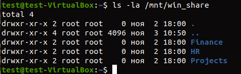
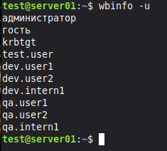

# Lab 05 — Файловый сервер Linux (NFS и Samba)

Практическая работа по развертыванию NFS-сервера и Samba-сервера с интеграцией в домен Active Directory.

## 🛠️ Часть 1. NFS-сервер и клиент
1.  **Сервер:** Установлен `nfs-kernel-server`, экспортирована папка `/srv/nfs/projects` для подсети `192.168.3.0/24` (rw,sync,root_squash).
2.  **Клиент:** С Ubuntu-клиента выполнено монтирование (`mount -t nfs`), проверено создание файла. `df -h` подтверждает работу NFS.

## 🛠️ Часть 2. Samba-сервер в домене AD
1.  **Интеграция с AD:** Выполнен ввод в домен через `realm join` и `net ads join`. Проверено через `wbinfo -u` и `getent`.
2.  **Настройка Samba:** В `smb.conf` настроен `security = ads`, `realm = LAB.LOCAL`. Создана шара `[linux_share]` с доступом для `test.user`.
3.  **Клиент (Linux):** С Ubuntu-клиента через `cifs-utils` успешно смонтирована шара Windows Server (`//192.168.3.61/CorporateData`), видны папки Finance, HR, Projects.

## 🐞 Разобранные проблемы (Troubleshooting)

*   **`Temporary failure in name resolution`:** Решено настройкой DNS на Ubuntu (отключение `systemd-resolved`, прописывание `192.168.3.61`).
*   **`Client 'administrator@LAB.LOCAL' not found`:** Решено использованием кириллического имени `Администратор`.
*   **`winbind: Could not fetch our SID`:** Решено повторным вводом в домен через `net ads join`.
*   **Ошибка 67 (Не найдено сетевое имя) при подключении с Windows 11 24H2:** Является известной проблемой совместимости SMB-подписи. Решено добавлением `server signing = mandatory` в `smb.conf` и настройкой клиента, однако Windows 11 24H2 блокирует подключение к Samba 4.15 на уровне протокола.
*   **Ошибка 86 (Неверный пароль):** Возникала при неверном вводе или устаревшем Kerberos-билете. Решено `klist purge`.
*   **Сильные задержки при выполнении команд на сервере:** Возникали из-за того, что `winbind` пытался проверить каждую группу через AD. Решено удалением `winbind` из `passwd` и `group` в `/etc/nsswitch.conf`.

## 📸 Визуализация

**Монтирование Windows-шары с Linux-клиента (CIFS):**

**Проверка домена (wbinfo -u):**

