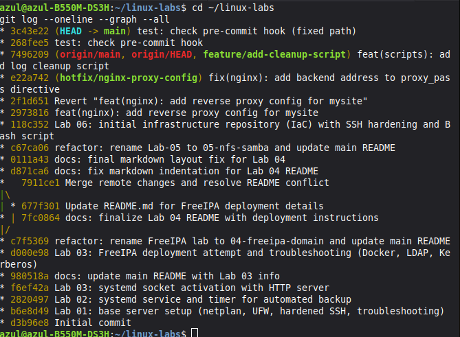

# Lab 06 — Инфраструктурный репозиторий (IaC) и продвинутый Git

Практическая работа по созданию правильной структуры инфраструктурного репозитория, настройке безопасности и освоению продвинутых практик Git (откаты, ветвление, хуки).

## 🛠️ Что сделано:

1.  **Структура репозитория:** Создана иерархия каталогов (`ansible`, `scripts/bash`, `scripts/powershell`, `configs/nginx`, `configs/ssh`, `configs/prometheus`, `docs`, `backups`).
2.  **Безопасность:** Создан `.gitignore` для защиты ключей, сертификатов, паролей и временных файлов от попадания в репозиторий.
3.  **Артефакты:**
    *   Добавлен hardened-конфиг SSH (`configs/ssh/sshd_config`).
    *   Написан Bash-скрипт `disk-usage-alert.sh` для мониторинга заполнения диска.
    *   Написана документация по безопасной настройке SSH (`docs/ssh-hardening.md`).

## 🌿 Продвинутые практики Git (Lab 02-04)

*   **Откат:** Освоен `git revert` для безопасной отмены коммитов (создание нового коммита вместо перезаписи истории).
*   **Ветвление:** Создание ветки `hotfix/nginx-proxy-config` для исправления конфига Nginx и слияние в `main`.
*   **Коллаборация:** Создана ветка `feature/add-cleanup-script`, имитация Pull Request через `git merge`.
*   **Stash:** Использован `git stash` для временного сохранения изменений без коммита.
*   **Поиск:** Использованы `git blame` и `git log -S` для поиска по истории изменений.
*   **Хуки:** Настроен `pre-commit` хук для автоматической проверки Bash-скриптов через `shellcheck`.

## 🐞 Разобранные проблемы (Troubleshooting)

*   **Конфликт путей при создании хука:** При создании `.git/hooks/pre-commit` внутри подпапки, Git не видел его, так как ожидает хук в корне репозитория. Решено указанием абсолютного пути `~/linux-labs/.git/hooks/pre-commit` и корректировкой пути к скриптам внутри самого хука (`find 06-git-infra/scripts/bash ...`).
*   **Проблема с кодировкой и слешами:** При настройке `git log -S` и `git blame` корректно отработали поиск по истории.

## 📸 Визуализация

**Работа с историей и откат коммита (revert + hotfix branch):**

