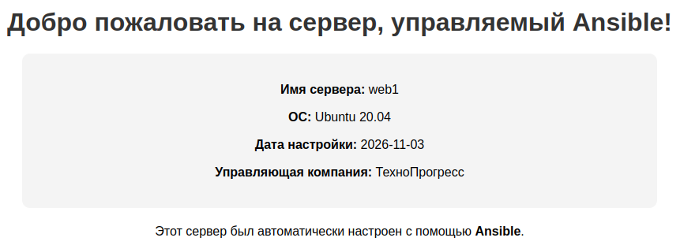

# Lab 07 — Автоматизация с Ansible

Практическая работа по установке Ansible, настройке SSH-доступа и написанию плейбуков для управления конфигурацией.

## 🛠️ Что сделано:
1.  **Установка:** Установлен Ansible (core 2.17) на Ubuntu Server (Control Node).
2.  **SSH-доступ:** Настроен вход без пароля на Managed Node (`192.168.3.60`).
3.  **Inventory:** Создан `inventory.ini` с группой `webservers`.
4.  **Ad-hoc команды:** Проверены `ping`, `uptime`, `setup`, установка пакетов (`htop`) и копирование файлов.
5.  **Плейбуки:**
    *   `bootstrap.yml` — базовые настройки (пакеты, часовой пояс, hostname).
    *   `deploy_nginx.yml` — установка Nginx, деплой кастомной HTML-страницы с Jinja2-шаблонизацией и handlers.
6.  **Отладка:** Освоены флаги `-vvv`, `--limit`, `--start-at-task`, а также `ansible-doc`.

## 📸 Визуализация

**Кастомная страница Nginx, развернутая через Ansible:**

