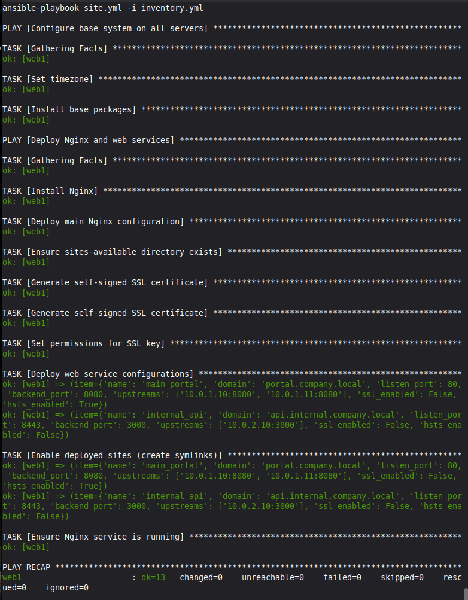
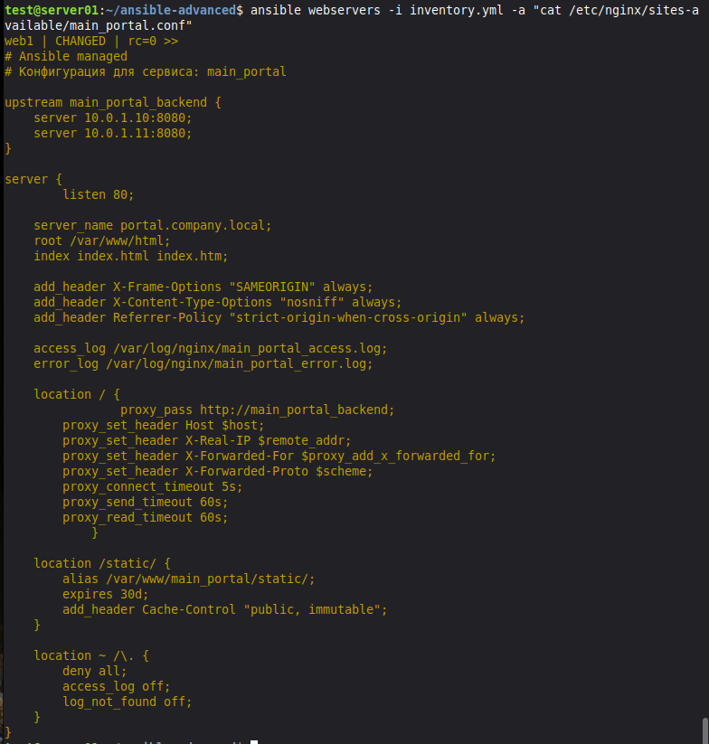

# Lab 08 — Продвинутый Ansible: шаблоны, переменные и хендлеры

Практическая работа по созданию масштабируемой системы управления конфигурацией с использованием `group_vars`, `host_vars`, шаблонов Jinja2 и циклов.

## 🛠️ Что сделано:
1.  **Структура:** Созданы каталоги `group_vars`, `host_vars`, `templates`, `handlers`.
2.  **Inventory:** Инвентарь переведен в YAML-формат (`inventory.yml`).
3.  **Переменные:** Настроены общие переменные (`group_vars/all.yml`) и специфичные для веб-серверов (`group_vars/webservers.yml` с массивом `web_services`).
4.  **Шаблоны Jinja2:** Написаны шаблоны `nginx.conf.j2` и `service.conf.j2` для генерации конфигов с поддержкой SSL и балансировки.
5.  **Плейбук `site.yml`:** Устанавливает пакеты, генерирует конфиги, использует `handlers` для перезагрузки Nginx.

## 🐞 Разобранные проблемы (Troubleshooting)
*   **`'item' is undefined`:** Решено заменой `item.name` на `service.name` при использовании `loop_control`.
*   **`'dict object' has no attribute 'hsts_enabled'`:** Решено добавлением `hsts_enabled: false` в переменные.
*   **Nginx не запускался (SSL):** Ошибка `cannot load certificate key: Permission denied`. Для успешного завершения лабораторной SSL для второго сервиса был отключен (`ssl_enabled: false`), так как настройка прав на файлы в `/etc/ssl/private/` требует дополнительной конфигурации.

## 📸 Визуализация

**Успешное выполнение плейбука (без ошибок):**

**Сгенерированный конфиг Nginx с балансировкой нагрузки:**

