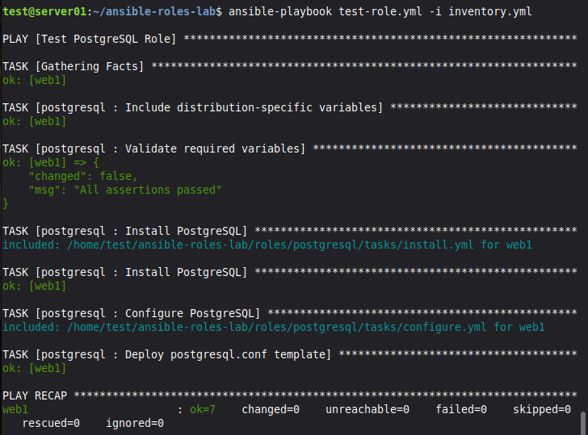

# Lab 09 — Создание Ansible Roles

Практическая работа по созданию переиспользуемых ролей (Roles) в Ansible на примере установки и настройки PostgreSQL.

## 🛠️ Что сделано:
1.  **Инициализация:** Роль создана через `ansible-galaxy init roles/postgresql` (получена стандартная структура: `tasks`, `defaults`, `handlers`, `templates`, `vars`).
2.  **Defaults:** В `defaults/main.yml` вынесены переменные (версия PostgreSQL, порт, настройки памяти).
3.  **Tasks:** Логика разбита на файлы (`install.yml`, `configure.yml`, `main.yml`).
    *   `install.yml` — установка пакета `postgresql`.
    *   `configure.yml` — деплой конфига из шаблона.
4.  **Templates:** Написан шаблон `postgresql.conf.j2` с подстановкой переменных.
5.  **Handlers:** Настроен обработчик `restart postgresql`, который срабатывает при изменении конфига.
6.  **Запуск:** Создан плейбук `test-role.yml`, который применяет роль к хосту `web1`.

## 🛠️ Продолжение: Связывание ролей (Роль django_app)

1.  **Роль `django_app`:** Создана вторая роль, которая настраивает окружение для приложения.
    *   Создает системного пользователя и группу `django`.
    *   Создает директорию приложения (`/opt/myapp`).
    *   Имитирует запуск миграций (`manage.py migrate`).
    *   Использует хендлер `restart gunicorn`.
2.  **Главный плейбук `site.yml`:** Связывает две роли. Сначала применяется роль `postgresql` (настройка БД), затем роль `django_app`. Передача переменных (пароль от БД) осуществляется через `vars`.
3.  **Идемпотентность:** При повторном запуске изменения не вносятся, что подтверждает корректность ролей.

## 🐞 Разобранные проблемы (Troubleshooting)
*   **Ошибка `expected a single document in the stream`:** Возникала из-за того, что `ansible-galaxy` создает файлы с комментариями, а мы добавляли свой `---`. Решено удалением дублирующихся комментариев.
*   **Ошибка `Could not find or access 'Debian.yml'`:** Решено созданием пустого файла `vars/Debian.yml`.
*   **Ошибка `Release file does not have...` (PostgreSQL 14):** Официальный репозиторий PostgreSQL больше не поддерживает Ubuntu 20.04 (focal). Решено установкой версии из стандартных репозиториев Ubuntu (версия 12).
*   **Ошибка `Destination directory /etc/postgresql/14/main does not exist`:** Из-за несовпадения версий (14 в переменных, 12 на деле). Решено изменением `postgresql_version` на `"12"`.

## 📸 Визуализация
**Успешное выполнение роли (генерация конфига и перезапуск службы):**

