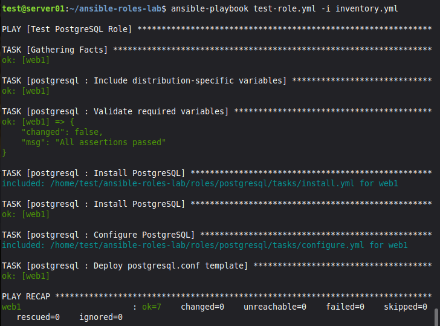
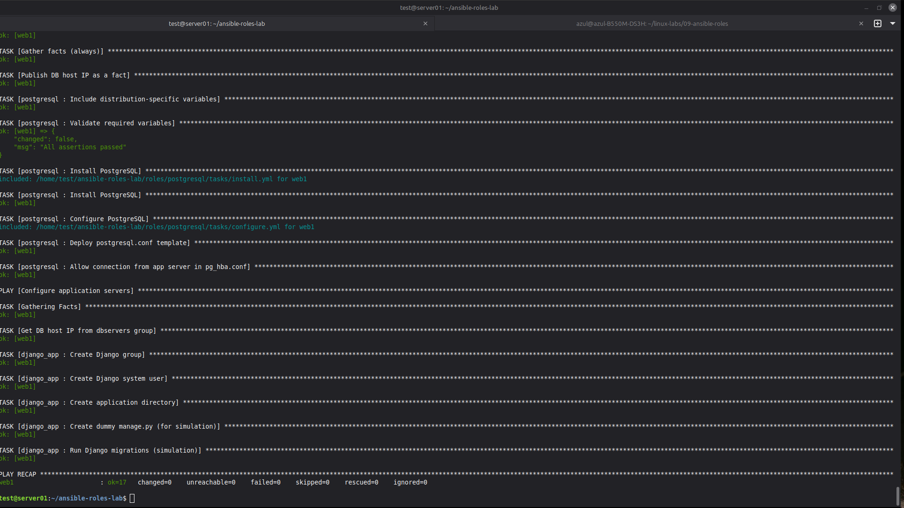

# Lab 09 — Создание Ansible Roles

Практическая работа по созданию переиспользуемых ролей (Roles) в Ansible на примере установки и настройки PostgreSQL.

## 🛠️ Что сделано:
1.  **Инициализация:** Роль создана через `ansible-galaxy init roles/postgresql` (получена стандартная структура: `tasks`, `defaults`, `handlers`, `templates`, `vars`).
2.  **Defaults:** В `defaults/main.yml` вынесены переменные (версия PostgreSQL, порт, настройки памяти).
3.  **Tasks:** Логика разбита на файлы (`install.yml`, `configure.yml`, `main.yml`).
    *   `install.yml` — установка пакета `postgresql`.
    *   `configure.yml` — деплой конфига из шаблона.
4.  **Templates:** Написан шаблон `postgresql.conf.j2` с подстановкой переменных.
5.  **Handlers:** Настроен обработчик `restart postgresql`, который срабатывает при изменении конфига.
6.  **Запуск:** Создан плейбук `test-role.yml`, который применяет роль к хосту `web1`.

## 🛠️ Продолжение: Связывание ролей (Роль django_app)

1.  **Роль `django_app`:** Создана вторая роль, которая настраивает окружение для приложения.
    *   Создает системного пользователя и группу `django`.
    *   Создает директорию приложения (`/opt/myapp`).
    *   Имитирует запуск миграций (`manage.py migrate`).
    *   Использует хендлер `restart gunicorn`.
2.  **Главный плейбук `site.yml`:** Связывает две роли. Сначала применяется роль `postgresql` (настройка БД), затем роль `django_app`. Передача переменных (пароль от БД) осуществляется через `vars`.
3.  **Идемпотентность:** При повторном запуске изменения не вносятся, что подтверждает корректность ролей.

## 🐞 Разобранные проблемы (Troubleshooting)
*   **Ошибка `expected a single document in the stream`:** Возникала из-за того, что `ansible-galaxy` создает файлы с комментариями, а мы добавляли свой `---`. Решено удалением дублирующихся комментариев.
*   **Ошибка `Could not find or access 'Debian.yml'`:** Решено созданием пустого файла `vars/Debian.yml`.
*   **Ошибка `Release file does not have...` (PostgreSQL 14):** Официальный репозиторий PostgreSQL больше не поддерживает Ubuntu 20.04 (focal). Решено установкой версии из стандартных репозиториев Ubuntu (версия 12).
*   **Ошибка `Destination directory /etc/postgresql/14/main does not exist`:** Из-за несовпадения версий (14 в переменных, 12 на деле). Решено изменением `postgresql_version` на `"12"`.

## 🚀 Продолжение: Продвинутые практики (Разделение, Vault, Facts)

В рамках развития лабораторной работы инфраструктура была разделена на логические группы, а секреты вынесены в защищенное хранилище.

1.  **Разделение на группы хостов (`dbservers` и `appservers`):**
    *   В `inventory.yml` хост `web1` добавлен в обе группы (так как физически это одна VM, но логически мы разделили роли).
    *   В `site.yml` созданы два отдельных `play`: один для `hosts: dbservers` (теги `[database, db]`), второй для `hosts: appservers` (теги `[application, app]`). Это позволяет запускать части инфраструктуры отдельно: `--tags database` или `--tags application`.
2.  **Передача переменных между ролями через `facts`:**
    *   В `play` для `dbservers` добавлен `pre_tasks` с `set_fact: db_host_ip: "{{ ansible_default_ipv4.address }}"` и тегом `tags: always` (чтобы факт собирался даже при запуске с `--tags application`).
    *   В `play` для `appservers` добавлен `pre_tasks`, который забирает IP базы данных из `hostvars[groups['dbservers'][0]]['db_host_ip']` и передает его в роль `django_app` как `django_db_host`.
3.  **Ansible Vault для секретов:**
    *   Пароль от БД больше не хранится в открытом виде в `site.yml`.
    *   Создан зашифрованный файл `group_vars/prod/vault.yml` (через `ansible-vault create`), содержащий `vault_blog_db_password`.
    *   Запуск плейбука теперь осуществляется с флагом `--ask-vault-pass` (или `--vault-password-file`).
4.  **Обновление `pg_hba.conf` и `postgresql.conf`:**
    *   В `defaults/main.yml` роли `postgresql` добавлен `192.168.3.60` в `listen_addresses`, чтобы СУБД слушала не только `localhost`.
    *   В `tasks/configure.yml` добавлен таск `lineinfile` для `pg_hba.conf`, разрешающий подключение с IP app-сервера (`192.168.3.60/32`).

## 🛡️ Управление зависимостями и CI/CD

1.  **`requirements.yml`:** Создан файл для управления внешними зависимостями. В него добавлена внешняя роль `geerlingguy.postgresql` (версия 3.0.0) и коллекция `community.general`.
2.  **CI/CD (GitHub Actions):** Создан файл `.github/workflows/ci.yml`. В нем настроены шаги:
    *   Установка Python и Ansible (матрица версий 2.14 / 2.15).
    *   Линтинг YAML (`yamllint`) и Ansible (`ansible-lint`).
    *   Проверка синтаксиса (`ansible-playbook --syntax-check`).
3.  **Настройка линтеров:** Создан `.yamllint` с мягкими правилами (line-length 160), чтобы избежать ложных срабатываний на длинных путях и truthy-значениях.

## 🧪 Тестирование (Molecule) и Git

1.  **Molecule:** В папке роли `postgresql` инициализирован сценарий тестирования (`molecule init scenario`). Создан `molecule/default/molecule.yml`. *Примечание: запуск `molecule test` требует Docker, которого нет на VM, но конфигурация готова к использованию в CI.*
2.  **Git:** Репозиторий инициализирован, создан `.gitignore` (исключены временные файлы, `.vault_pass` и т.д.). Сделан коммит и проставлен тег `v1.0.0`.

## 🐞 Troubleshooting (Продолжение)
В ходе доработки возникли новые нетривиальные проблемы:

*   **Ошибка `undefined variable 'ansible_default_ipv4'` при `--tags application`:**
    *   *Причина:* При фильтрации по тегам, `play` для БД полностью пропускался (включая сбор фактов), поэтому `db_host_ip` не собирался.
    *   *Решение:* Добавлена задача `Gather facts (always)` (`ansible.builtin.setup`) и `set_fact` с тегом `tags: always` в первый `play`.
*   **Ошибка `no pg_hba.conf entry for host "192.168.3.50"`:**
    *   *Причина:* `psql` запускался с контроллера (192.168.3.50), а `pg_hba` разрешал только app-сервер (192.168.3.60).
    *   *Решение:* Добавлена строка `host all all 192.168.3.50/32 md5` в `pg_hba.conf` (опционально для отладки).
*   **`become` не срабатывал (`whoami` возвращал `test`, а не `root`):**
    *   *Причина:* Отсутствие прав на беспарольный `sudo` на целевой машине.
    *   *Решение:* Настроен NOPASSWD в sudoers для пользователя `test` на хосте `web1`.
*   **Идемпотентность ломалась на таске миграций Django (`changed=1`):**
    *   *Причина:* Модуль `command` всегда возвращает `changed`, если команда завершилась с `rc=0`.
    *   *Решение:* В `manage.py` добавлено создание маркер-файла `.migrated` при успешном выполнении. В таск добавлен параметр `creates: "{{ django_app_path }}/.migrated"`. Теперь при повторном запуске таск пропускается.
*   **`ansible-lint` завершался с кодом 1 (`AnsibleCollectionFinder has not been installed`):**
    *   *Причина:* Известная несовместимость старой версии `ansible-lint 5.4.0` (из apt) с `ansible-core 2.16+` (из pip).
    *   *Решение:* Ошибка игнорируется локально, так как в CI используется современная версия. `yamllint` при этом проходит чисто.

---

## 📸 Визуализация
**Успешное выполнение роли (генерация конфига и перезапуск службы):**

**Успешное выполнение после разделения групп и настройки Vault:**

