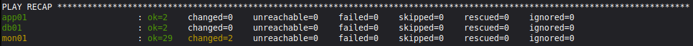
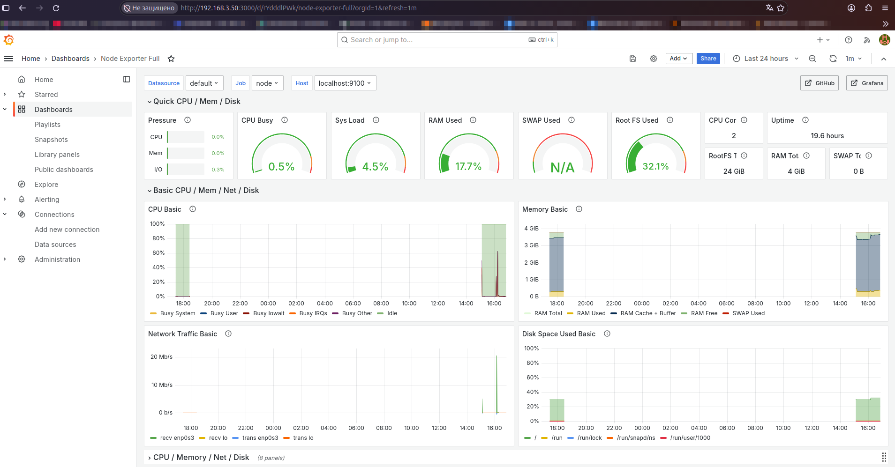
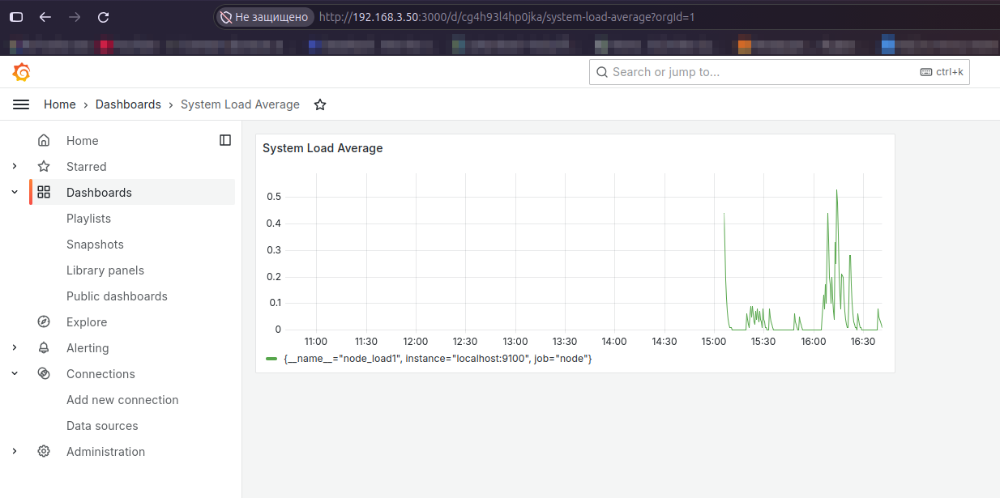

# Lab 11 - Визуализация метрик с помощью Grafana

Этот проект содержит Ansible-роль для автоматической установки и настройки **Grafana** — системы визуализации данных.

## 📦 Что разворачивается?
**Grafana** — мощный инструмент для построения дашбордов (порт 3000). В рамках этой лабораторной мы настраиваем её так, чтобы она автоматически подключалась к **Prometheus** (который был установлен в Лабе 10) и загружала готовые графики.

## 🚀 Как запустить?
1. Убедитесь, что у вас установлен Ansible.
2. Проверьте файл инвентаря `inventories/production/hosts.ini`.
3. Запустите плейбук.

## 🔍 Как проверить, что всё работает?

1. Откройте http://<IP-сервера>:3000 (Логин: admin, Пароль: admin).
2. Перейдите в Dashboards -> General.
3. Откройте дашборд Node Exporter Full — вы увидите графики загрузки CPU, памяти и дисков, собранные из Prometheus.
4. В разделе Connections -> Data Sources должен быть настроен Prometheus (зеленая галочка).

## 🐞 Решенные проблемы (Troubleshooting)

1. Ошибка Could not find or access 'Debian.yml':
   Решение: Создан пустой файл roles/grafana/vars/Debian.yml.

2. Веб-интерфейс не открывался в браузере:
   Решение: Открыт порт в файрволе: sudo ufw allow 3000/tcp. 

3. Ошибка yaml: line 13: could not find expected ':' при запуске Grafana:
   Причина: Ошибка в шаблоне Jinja2 при генерации datasources.yml (неправильные отступы).
   Решение: Упрощен шаблон, убрана сложная структура json_data.

4. Ошибка src file does not exist (симлинк Grafana):
   Причина: Архив распаковался в папку grafana-v10.4.2, а скрипт искал grafana-10.4.2.
   Решение: Использован модуль find для динамического поиска папки перед созданием симлинка.

## 📸 Визуализация

**Успешный запуск Ansible-плейбука:**

**Готовый дашборд Node Exporter в Grafana:**

**Собственная панель мониторинга нагрузки (System Load Average):**

