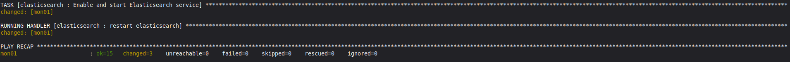
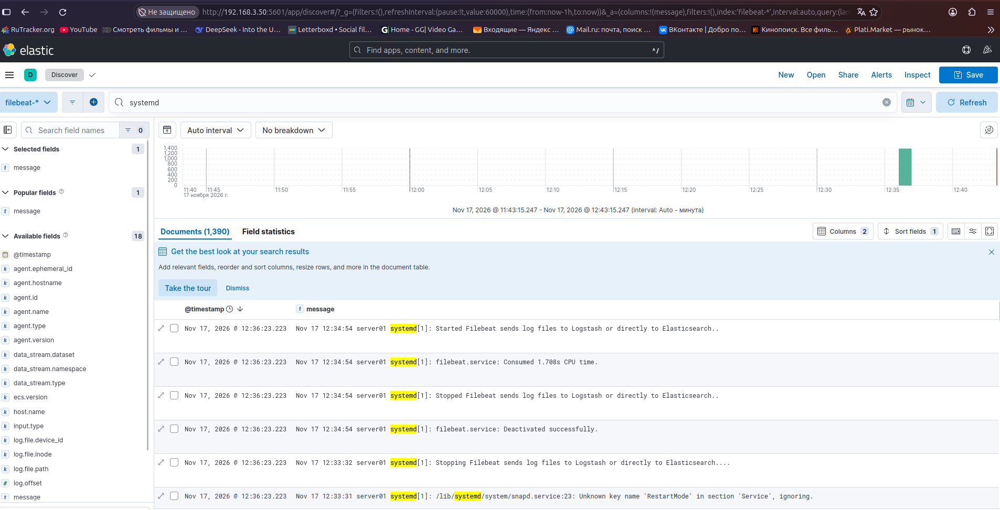

# Лабораторная 12: Развертывание ELK Stack

Этот проект содержит Ansible-роли для автоматической установки Elasticsearch, Kibana и Filebeat.

## 📦 Что разворачивается?
1.  **Elasticsearch** — поисковый движок и база данных (порт 9200).
2.  **Kibana** — веб-интерфейс для визуализации логов (порт 5601).
3.  **Filebeat** — агент для сбора и отправки логов с серверов в Elasticsearch.

## 🚀 Как запустить?
bash
ansible-playbook site.yml -i inventories/production/hosts.ini -K

## 🔍 Как проверить?
1. Откройте http://<IP-сервера>:5601.

2. Перейдите в Stack Management -> Data Views (должен быть filebeat-*).

3. Перейдите в Discover и выберите диапазон времени Last 15 minutes. Вы увидите системные логи.

## 📸 Визуализация

**Успешный запуск ELK-стека:**

**Поиск логов в Kibana:**

