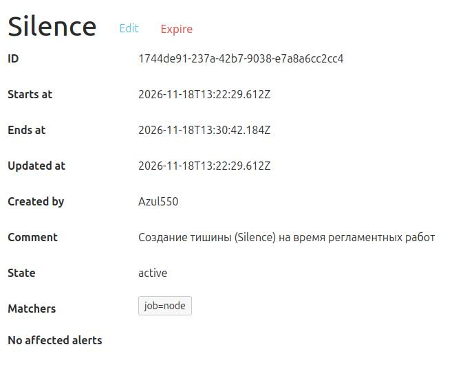
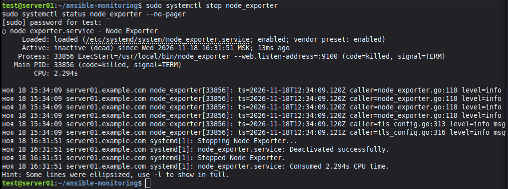
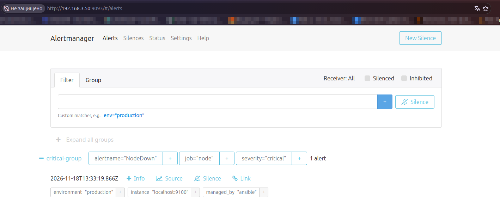
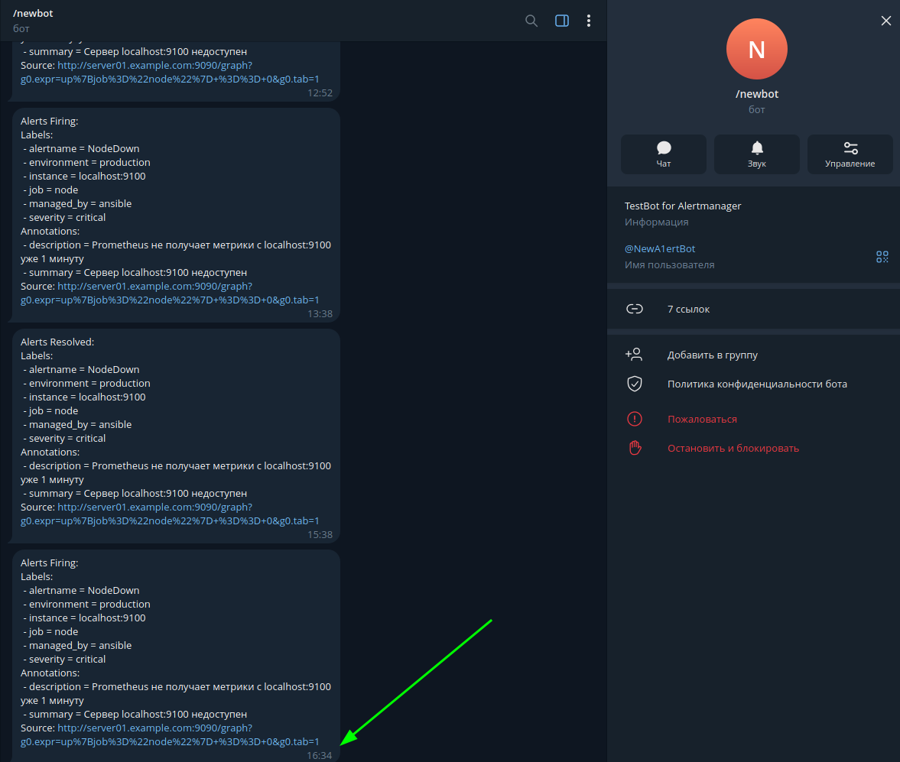
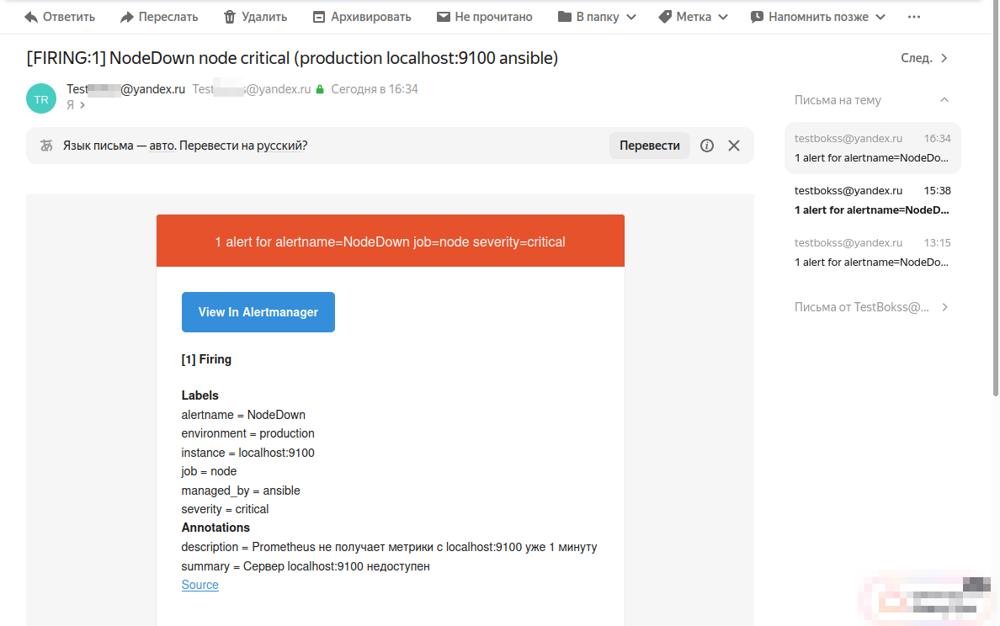
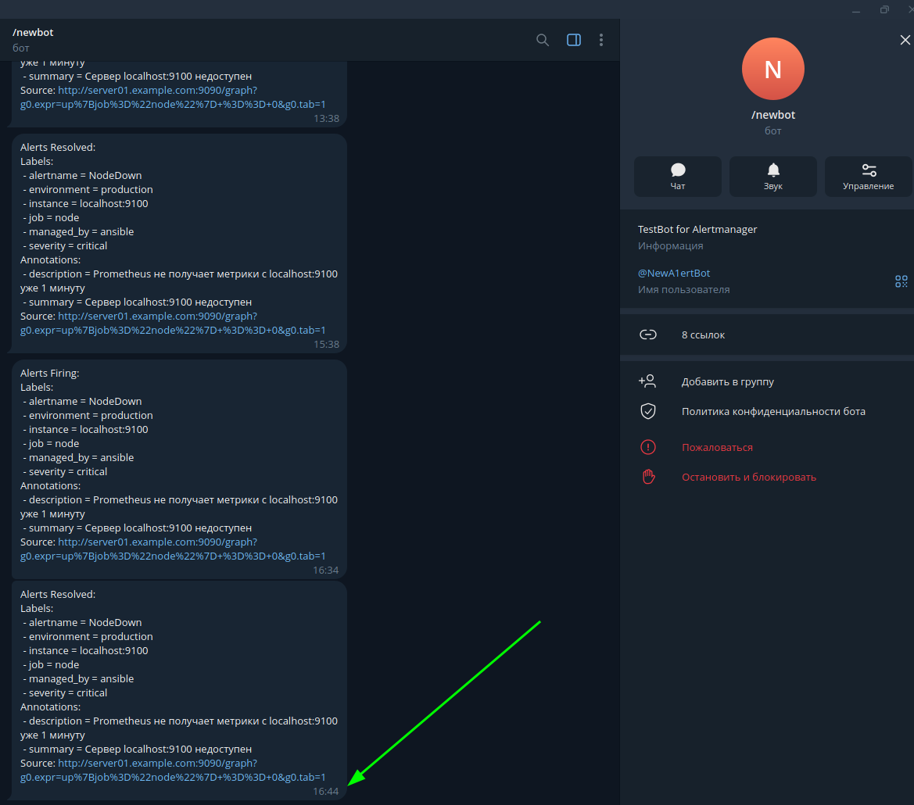
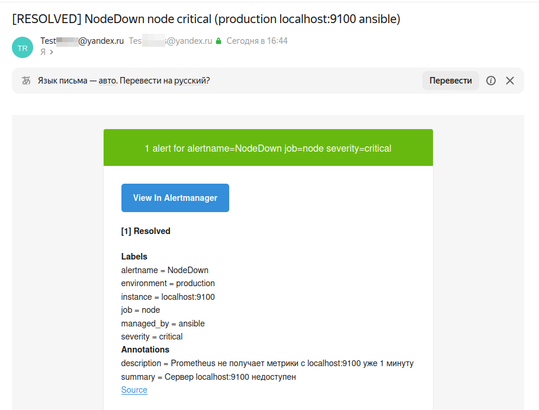

# Lab 13 - Настройка уведомлений и алертинга с помощью Alertmanager

Этот проект содержит Ansible-роль для автоматической установки и настройки **Prometheus Alertmanager** (порт `9093`), маршрутизации критических инцидентов в **Telegram** и **Email**, а также правил подавления (Inhibition) и тишины (Silence).

## 📦 Что разворачивается?
* **Alertmanager** — система обработки, группировки и маршрутизации уведомлений от Prometheus (порт `9093`).
* **Правила алертинга (`node_alerts.yml`)** — мониторинг доступности узлов (`NodeDown`), высокой нагрузки CPU, памяти и места на диске.
* **Двухканальная доставка (`critical-group`)** — одновременная отправка критических алертов в **Telegram** (для мгновенного реагирования) и на **Email** через SMTP Яндекса (для архива и отчётности).
* **Механизмы защиты от шума** — правила ингибирования (`inhibit_rules`) для подавления дублирующих warning-алертов и создание окон тишины (`Silence`) на время регламентных работ.

## 🚀 Как запустить?
1. Убедитесь, что у вас установлен Ansible и настроен доступ по SSH.
2. Проверьте файл инвентаря `inventories/production/hosts.ini`.
3. При необходимости обновите секреты (токен бота Telegram, `chat_id`, логин и пароль приложения Яндекс.Почты) в зашифрованном файле:
   ```bash
   ansible-vault edit group_vars/all/vault.yml
   ```
4. Запустите плейбук с запросом пароля Vault и пароля `sudo`:
   ```bash
   ansible-playbook -i inventories/production/hosts.ini site.yml --limit mon01 --tags alertmanager --ask-vault-pass --ask-become-pass
   ```

## 🔍 Как проверить, что всё работает?

1. Проверьте статус сервисов:
   * Prometheus: `http://192.168.3`
   * Alertmanager: `http://192.168.3`
2. Создайте окно тишины (**Silence**) в веб-интерфейсе Alertmanager (`Status -> Silences -> New Silence` для метки `job="node"`), убедитесь в его активации, затем завершите (`Expire`) для проведения теста.
3. Имитируйте сбой на сервере, остановив экспортер:
   ```bash
   sudo systemctl stop node_exporter
   ```
4. Через 1 минуту правило `NodeDown` в Prometheus перейдет из `PENDING` в `FIRING`, после чего в Telegram и на почту придут уведомления о сбое.
5. Запустите службу обратно:
   ```bash
   sudo systemctl start node_exporter
   ```
6. После восстановления сбора метрик в оба канала придут закрывающие уведомления со статусом **RESOLVED**.

## 🐞 Решенные проблемы (Troubleshooting)

1. **Таймаут подключения к `api.telegram.org` с виртуальной машины:**
   * **Причина:** Сетевые ограничения провайдера/ТСПУ блокировали прямой доступ виртуальной машины к серверам Telegram, в то время как VPN (WireGuard) был поднят только на хост-машине.
   * **Решение:** На хост-машине (`192.168.3`) поднят легкий HTTP-прокси `tinyproxy` на порту `8888`, разрешен доступ из локальной подсети (`Allow 192.168.3.0/24` и правило `ufw`), а в конфигурацию `alertmanager.yml` добавлен параметр `http_config.proxy_url`.

2. **Ошибка `cannot unmarshal !!str into int64` при запуске Alertmanager:**
   * **Причина:** Шаблон Jinja2 оборачивал переменную `chat_id` в кавычки, из-за чего Alertmanager воспринимал её как строку вместо целого числа.
   * **Решение:** В шаблоне `roles/alertmanager/templates/alertmanager.yml.j2` добавлен фильтр приведения типа `{{ config.chat_id | int }}`.

3. **Ошибка `telebot: invalid character '<' looking for beginning of value`:**
   * **Причина:** Конфликт при одновременном указании локального `api_url` внутри блока `telegram_configs` и прокси-сервера, из-за чего в ответ возвращалась HTML-страница.
   * **Решение:** Убрано дублирование `api_url` внутри `telegram_configs`, оставлен только глобальный `telegram_api_url` в секции `global`.

4. **Ошибка `sudo: a password is required` при запуске плейбука:**
   * **Причина:** Выполнение задач установки и перезапуска системных служб требует повышения привилегий на целевом хосте.
   * **Решение:** Запуск плейбука выполнен с флагом `--ask-become-pass`.

## 📸 Визуализация

**Создание окна тишины (Silence) на время регламентных работ:**


**Имитация падения сервиса (остановка `node_exporter`):**


**Срабатывание правила `NodeDown` (`FIRING`) в Prometheus:**


**Активный алерт в веб-интерфейсе Alertmanager:**


**Уведомление о сбое (`FIRING`) в Telegram:**


**Уведомление о сбое (`FIRING`) на Email:**


**Уведомление о восстановлении (`RESOLVED`) в Telegram:**


**Уведомление о восстановлении (`RESOLVED`) на Email:**

