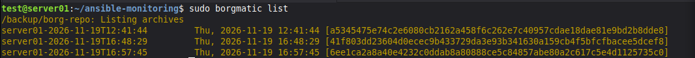
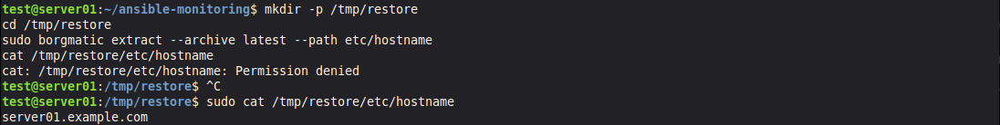
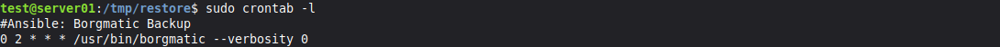
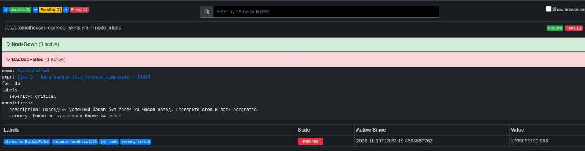
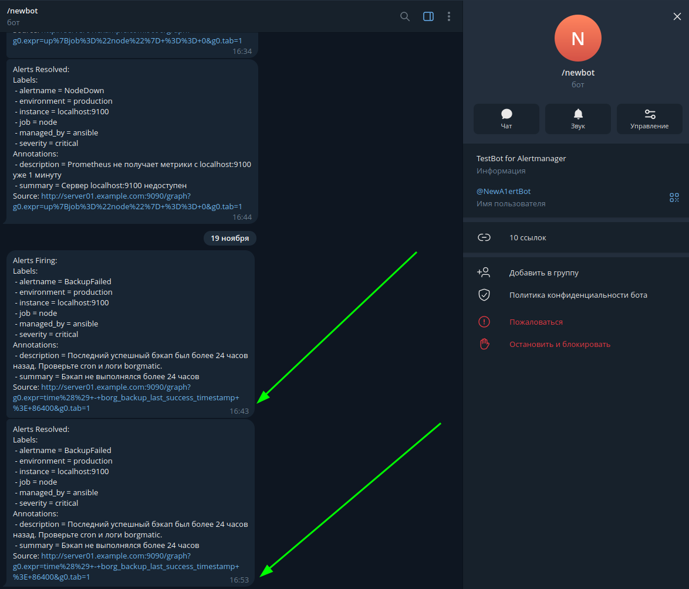
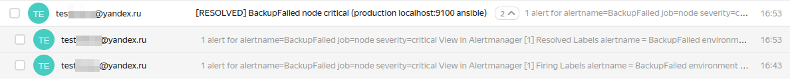
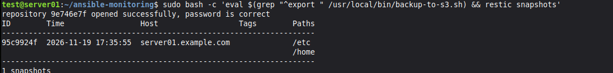
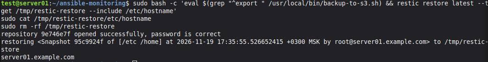
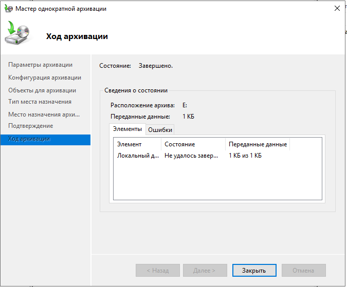
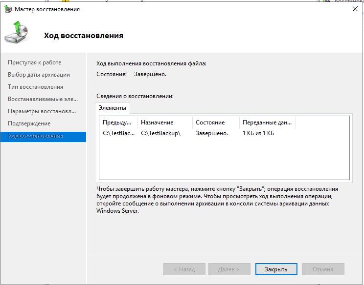

# Lab 14 - Резервное копирование и восстановление данных (BorgBackup, Restic S3, Windows Backup)

Этот проект содержит Ansible-роли для автоматизации резервного копирования Linux-серверов с использованием **BorgBackup** (`borgmatic`) и **Restic** (в S3-совместимое объектное хранилище), интеграцию с мониторингом **Prometheus/Alertmanager**, а также практику резервного копирования на **Windows Server**.

## 📦 Что разворачивается и настраивается?
* **Роль `borgbackup` (`borgmatic`):**
  * Локальный зашифрованный репозиторий (`repokey-blake2`) с блочной дедупликацией и сжатием.
  * Политика хранения по схеме **GFS** (`7 daily`, `4 weekly`, `6 monthly`) и ежедневный запуск по `cron` в `02:00`.
  * Выгрузка метрики `borg_backup_last_success_timestamp` в `node_exporter` (textfile collector) через хук `after_backup`.
* **Роль `restic` + локальный S3-эмулятор:**
  * Развертывание S3-совместимого хранилища на порту `9000` и инициализация зашифрованного бакета.
  * Скрипт `/usr/local/bin/backup-to-s3.sh` с автоматической ротацией `forget --prune` и запуском по `cron` в `03:00`.
* **Алертинг бэкапов (`BackupFailed`):**
  * Правило Prometheus отслеживает актуальность последнего успешного бэкапа (`time() - borg_backup_last_success_timestamp > 86400`) и отправляет критические уведомления (`FIRING` / `RESOLVED`) в **Telegram** и **Email**.
* **Windows Server Backup (`wbadmin`):**
  * Настройка резервного копирования файлов на отдельный виртуальный диск VHDX и гранулярное восстановление удаленных файлов.

## 🚀 Как запустить?
1. Убедитесь, что у вас установлен Ansible и настроен доступ по SSH.
2. Запустите плейбук для развертывания ролей резервного копирования:
   ```bash
   ansible-playbook -i inventories/production/hosts.ini site.yml --limit mon01 --tags borg,restic --ask-vault-pass --ask-become-pass
   ```

## 🔍 Как проверить, что всё работает?

1. **Проверка BorgBackup:**
   ```bash
   sudo borgmatic --verbosity 1
   sudo borgmatic list
   ```
2. **Проверка Restic S3 и дедупликации:**
   ```bash
   sudo /usr/local/bin/backup-to-s3.sh
   cat /var/log/restic-backup.log
   ```
3. **Проверка метрик для Prometheus:**
   ```bash
   cat /var/lib/prometheus/node-exporter/borg_backup.prom
   ```

## 🐞 Решенные проблемы (Troubleshooting)

1. **Хук `after_backup` в `borgmatic` не записывал метрику в `.prom`-файл:**
   * **Причина:** В версии `borgmatic` из репозиториев Ubuntu команды в `hooks` без явного вызова оболочки не обрабатывают символ перенаправления вывода `>`.
   * **Решение:** Команда записи метрики обернута в `sh -c '...'`, а в задачу Ansible добавлен параметр `force: no`, чтобы повторный запуск плейбука не сбрасывал timestamp в `0`.

2. **Ошибка `HTTP Error 403: Forbidden` и закрытие бинарников MinIO:**
   * **Причина:** Ограничения доступа и прекращение публичной раздачи готовых бинарных сборок MinIO.
   * **Решение:** Развернут локальный S3-совместимый сервер на базе `moto_server` в изолированном Python venv на порту `9000`.

3. **Ошибка `wbadmin`: запрет сохранения архива на тот же том `C:`:**
   * **Причина:** Система архивации данных Windows Server не позволяет использовать в качестве хранилища том, включенный в состав резервной копии.
   * **Решение:** Создан и подключен динамический виртуальный диск VHDX размером 1 ГБ (отформатированный в NTFS), на который успешно выполнена архивация и последующее восстановление файлов.

## 📸 Визуализация

**Список локальных зашифрованных архивов BorgBackup:**


**Тестовое восстановление файла из архива Borg:**


**Расписание задач резервного копирования в Cron:**


**Срабатывание правила `BackupFailed` (`FIRING`) в Prometheus:**


**Уведомления о сбое и восстановлении бэкапа в Telegram:**


**Уведомления о сбое и восстановлении бэкапа на Email:**


**Лог создания снапшотов Restic в S3 и блочной дедупликации (`0 B`):**


**Восстановление файла из S3-снапшота Restic:**


**Выполнение резервного копирования в Windows Server Backup:**


**Восстановление удаленного файла в Windows Server:**

