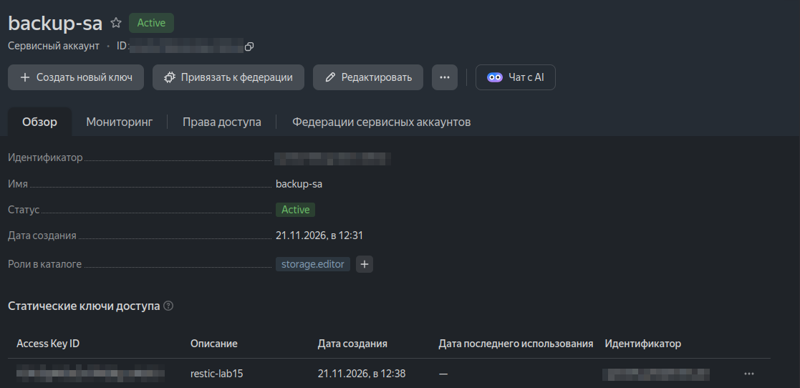
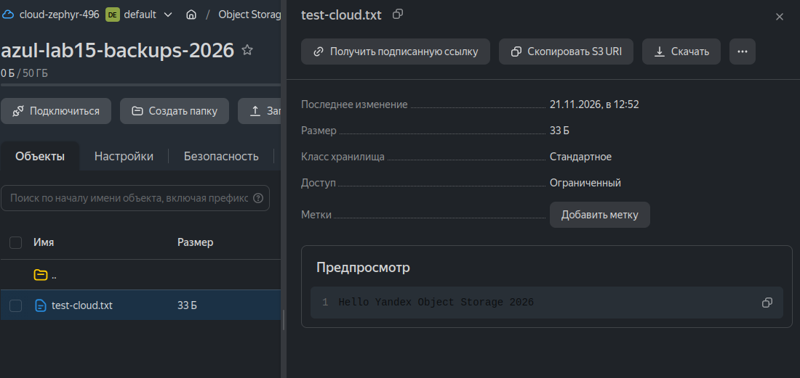
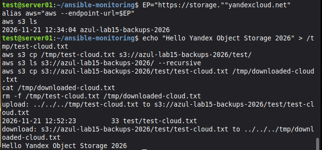
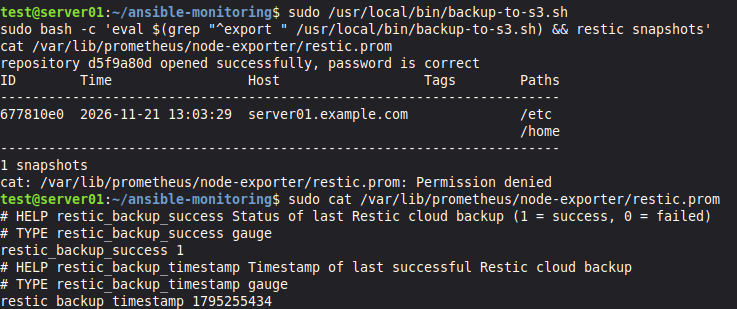
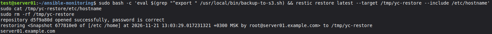
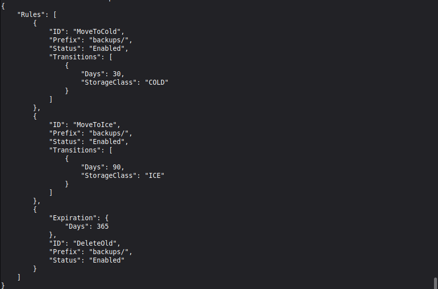
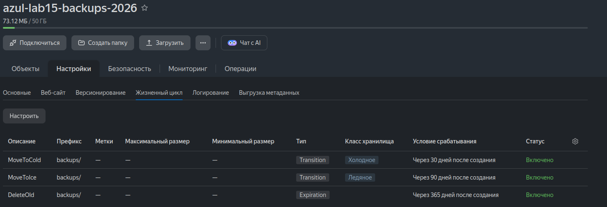

# Lab 15 - Облачное объектное хранилище S3 и резервное копирование в Yandex Cloud (AWS CLI, Restic, Ansible)

Этот проект посвящён настройке облачного объектного хранилища **Yandex Object Storage**, управлению бакетами через **AWS CLI**, настройке политик жизненного цикла (**Lifecycle**) для оптимизации стоимости хранения, а также автоматизации шифрованного резервного копирования в облако с помощью **Restic** и **Ansible**.

## 📦 Что разворачивается и настраивается?
* **Облачная инфраструктура (Yandex Cloud):**
  * Сервисный аккаунт `backup-sa` с минимально необходимыми правами (`storage.editor`) и статическими ключами доступа, защищёнными через **Ansible Vault**.
  * Приватный бакет `azul-lab15-backups-2026` класса `STANDARD`.
* **Управление через AWS CLI и Lifecycle Policy:**
  * Базовые операции с объектами (`aws s3 ls`, `cp`, `sync`).
  * Политика жизненного цикла (`lifecycle.json`): переход объектов префикса `backups/` в холодное хранилище (`COLD`) через 30 дней, в ледовое (`ICE`) через 90 дней и автоматическое удаление через 365 дней.
* **Автоматизация через Ansible (`yandex-cloud-s3` и `restic`):**
  * Идемпотентное создание бакета и применение правил жизненного цикла.
  * Ежедневное резервное копирование `/etc` и `/home` в облачный S3-репозиторий с клиентским шифрованием AES-256, ротацией GFS (`7/4/6`), еженедельной проверкой целостности (`restic check`) и выгрузкой метрик в `node_exporter`.

## 🚀 Как запустить?
1. Убедитесь, что статические ключи сервисного аккаунта и пароль репозитория Restic добавлены в зашифрованный `group_vars/all/vault.yml`.
2. Запустите плейбук развертывания облачного резервного копирования:
   ```bash
   ansible-playbook -i inventories/production/hosts.ini site.yml --limit mon01 --tags restic --ask-vault-pass --ask-become-pass
   ```

## 🔍 Как проверить, что всё работает?

1. **Проверка содержимого бакета через AWS CLI:**
   ```bash
   aws --endpoint-url=https://storage.yandexcloud.net s3 ls s3://azul-lab15-backups-2026/ --recursive
   ```
2. **Проверка облачных снапшотов Restic и метрик:**
   ```bash
   sudo bash -c 'eval \$(grep "^export " /usr/local/bin/backup-to-s3.sh) && restic snapshots'
   cat /var/lib/prometheus/node-exporter/restic.prom
   ```

## 🐞 Решенные проблемы (Troubleshooting)

1. **Игнорирование `endpoint_url` из `~/.aws/config` в старой версии `aws-cli`:**
   * **Причина:** В версии `aws-cli 1.22` из репозиториев Ubuntu параметр `s3.endpoint_url` в конфиге не подхватывается автоматически, из-за чего утилита обращается к `://amazonaws.com`.
   * **Решение:** Передача адреса Яндекс.Облака явно через флаг `--endpoint-url https://storage.yandexcloud.net`.

2. **Ошибка валидации `Parameter validation failed: Unknown parameter "Id"` при применении `lifecycle.json`:**
   * **Причина:** Библиотека `botocore` требует строгого написания ключа идентификатора правила в верхнем регистре (`"ID"` вместо `"Id"`).
   * **Решение:** Исправление регистра ключа `"ID"` в `lifecycle.json` и шаблоне Ansible `lifecycle.json.j2`.

3. **Ошибка `Permission denied` при чтении файла метрик `restic.prom`:**
   * **Причина:** Скрипт резервного копирования выполняется от имени `root`, создавая файл с закрытыми правами чтения для пользователя `prometheus`.
   * **Решение:** Добавление явной установки прав `chmod 0644 /var/lib/prometheus/node-exporter/restic.prom` после генерации метрик.

## 📸 Визуализация

**Сервисный аккаунт `backup-sa` с ролью `storage.editor`:**


**Приватный бакет `azul-lab15-backups-2026` в Yandex Object Storage:**


**Работа с бакетом через AWS CLI (`ls`, `cp`):**


**Создание облачного снапшота Restic и выгрузка метрик в Prometheus:**


**Тестовое восстановление файла из облачного репозитория Restic:**


**Применение политики жизненного цикла бакета (`MoveToCold`, `MoveToIce`, `DeleteOld`):**


**Правила жизненного цикла во вкладке бакета в консоли Яндекс.Облака:**

